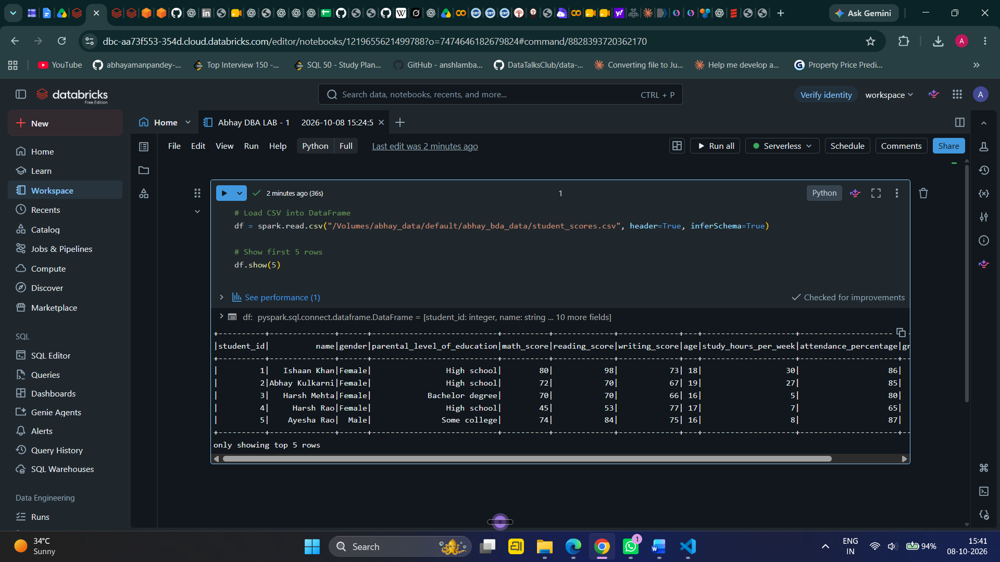
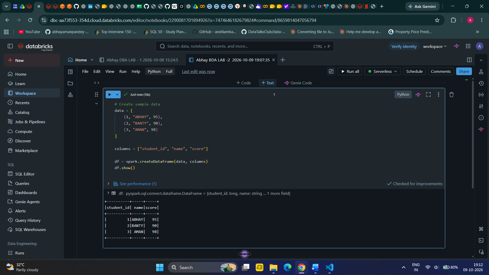
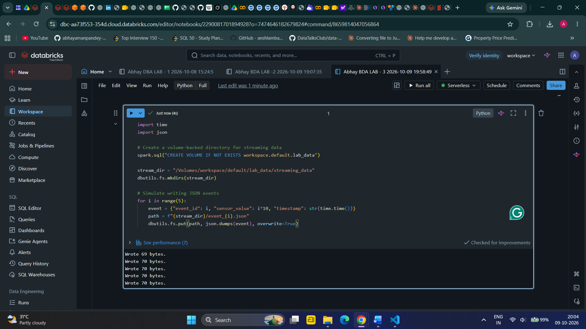
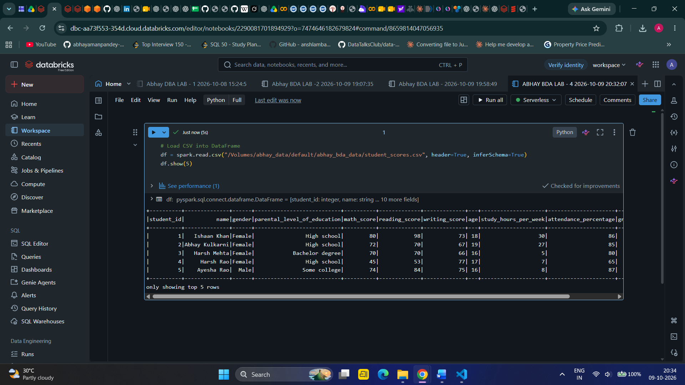
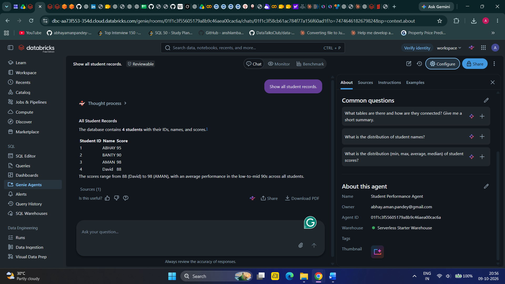

# Big Data Analytics | Databricks Lab Assignments

**A hands-on exploration of Apache Spark, Delta Lake, Structured Streaming, DataFrame transformations, and conversational analytics using Databricks.**

    

## Overview

This repository documents five practical assignments completed for **Big Data Analytics (BE Computer Engineering, 2026–27)**. The exercises progress from querying CSV datasets with Spark SQL to Delta Lake versioning, simulated streaming ingestion, DataFrame processing, and natural-language exploration with Databricks Genie.

The repository contains exported Databricks notebooks for Labs 1–4, two CSV datasets, and **35 labeled execution screenshots** covering Labs 1–5. Lab 5 is documented through screenshots; a separate exported Lab 5 notebook is not currently included.

## Lab Summary

| Lab | Experiment | Main concepts | Evidence |
|:---:|---|---|:---:|
| 01 | Spark SQL Basics | CSV ingestion, temporary views, `SELECT`, `GROUP BY`, `ORDER BY` | 9 screenshots |
| 02 | Delta Lake Time Travel | Delta tables, updates, appends, table history, version reads | 6 screenshots |
| 03 | Streaming Data Simulation | JSON file source, `readStream`, streaming aggregation, memory sink | 6 screenshots |
| 04 | DataFrame Transformations | Filtering, selection, aggregation, joins, sorting | 7 screenshots |
| 05 | Databricks Genie Demo | Natural-language questions, SQL-backed analytics and visual exploration | 7 screenshots |

## Technology Stack

- **Platform:** Databricks
- **Processing:** Apache Spark / PySpark
- **Queries:** Spark SQL
- **Table format:** Delta Lake
- **Streaming:** Spark Structured Streaming (simulated JSON file ingestion)
- **Data governance and storage:** Databricks Unity Catalog volumes and tables, where configured in the notebooks
- **Conversational analytics:** Databricks Genie (Lab 5)
- **Data formats:** CSV and JSON
- **Artifacts:** Jupyter notebooks (`.ipynb`) and PNG screenshots

## Repository Structure

```text
BDA-Databricks-Assignment/
├── Notebook/
│   ├── Abhay DBA LAB - 1  2026-10-08 15_24_5.ipynb
│   ├── Abhay BDA LAB -2  2026-10-09 19_07_35.ipynb
│   ├── Abhay BDA LAB -3  2026-10-09 19_58_49.ipynb
│   └── ABHAY BDA LAB - 4 2026-10-09 20_32_07.ipynb
├── Output_Lab-1/             # 9 screenshots
├── Output_Lab-2/             # 6 screenshots
├── Output_Lab-3/             # 6 screenshots
├── Output_Lab-4/             # 7 screenshots
├── Output_Lab-5/             # 7 screenshots
├── bda_datasets_50000_records (1)/
│   ├── student_scores.csv
│   └── retail_sales.csv
├── main.py
├── pyproject.toml
└── README.md
```

## Experiments

### Lab 01 — Spark SQL Basics

**Objective:** Import a CSV dataset into Databricks and perform SQL-based analysis.

The notebook reads `student_scores.csv` into a Spark DataFrame, registers a temporary SQL view, and runs queries to inspect records, count students by gender, calculate average mathematics scores by parental education, and identify the top reading scores.

**Key takeaway:** Spark SQL provides a familiar SQL interface for analyzing data using Spark's distributed processing engine.

**[Notebook](Notebook/Abhay%20DBA%20LAB%20-%201%20%202026-10-08%2015_24_5.ipynb) · [All outputs](Output_Lab-1/)**



### Lab 02 — Delta Lake Time Travel

**Objective:** Explore Delta Lake table updates and historical versions.

The notebook creates a student-score DataFrame, writes a Delta table, updates a student's score, appends a new record, inspects table history, and reads earlier versions. Its example uses a named Databricks table (`workspace.default.students`).

**Key takeaway:** Delta Lake's transaction log supports versioned reads and makes changes auditable, subject to retention of historical data files.

**[Notebook](Notebook/Abhay%20BDA%20LAB%20-2%20%202026-10-09%2019_07_35.ipynb) · [All outputs](Output_Lab-2/)**



### Lab 03 — Streaming Data Simulation

**Objective:** Simulate an incoming JSON event stream and process it with Structured Streaming.

The notebook creates a volume-backed directory, writes simulated sensor events, defines a streaming JSON source with an explicit schema, calculates average sensor values, and queries the streaming result through SQL.

**Key takeaway:** Structured Streaming provides a unified Spark API for processing incremental data, even when the source is simulated using files rather than a live message broker.

**[Notebook](Notebook/Abhay%20BDA%20LAB%20-3%20%202026-10-09%2019_58_49.ipynb) · [All outputs](Output_Lab-3/)**



### Lab 04 — DataFrame Transformations

**Objective:** Apply essential PySpark DataFrame operations to student data.

The notebook loads student scores and demonstrates filtering students with high mathematics marks, selecting columns, calculating average scores by gender, joining a small hobbies dataset, and sorting students by writing score.

**Key takeaway:** DataFrame transformations offer a composable approach to preparing, combining, and summarizing structured data.

**[Notebook](Notebook/ABHAY%20BDA%20LAB%20-%204%202026-10-09%2020_32_07.ipynb) · [All outputs](Output_Lab-4/)**



### Lab 05 — Databricks Genie Demo

**Objective:** Explore conversational analytics using natural-language questions about a dataset.

This lab focuses on configuring and using a Genie space with accessible data and asking analytical questions without manually writing each SQL statement. The repository includes screenshots of the lab output and interface, but no separate Lab 5 notebook export.

**Key takeaway:** Conversational business intelligence can help users explore governed datasets through natural-language questions and inspect the resulting analytics.

**[All outputs](Output_Lab-5/)**



## Datasets

| Dataset | File | Primary use |
|---|---|---|
| Student performance | [`student_scores.csv`](bda_datasets_50000_records%20(1)/student_scores.csv) | Spark SQL and DataFrame analysis |
| Retail sales | [`retail_sales.csv`](bda_datasets_50000_records%20(1)/retail_sales.csv) | Additional tabular analytics exercises |

The CSVs are provided for educational experimentation. Dataset contents are illustrative; they should not be treated as real institutional or commercial records.

## Reproducing the Labs

1. Open a Databricks workspace with Spark compute access.
2. Upload the datasets into a Unity Catalog volume (or adjust the paths to your own storage location).
3. Import the relevant `.ipynb` file from the `Notebook/` directory.
4. Review and update hard-coded catalog, schema, volume, and table paths before executing cells. For example, some notebooks reference `/Volumes/abhay_data/default/abhay_bda_data/` or `workspace.default.students`.
5. Run the cells in order and compare the results with the matching `Output_Lab-*` screenshots.
6. For Lab 5, configure an appropriate Genie space and SQL warehouse in your own Databricks environment, then use the screenshot folder as a reference.

> **Note:** Availability of Unity Catalog, Genie, SQL warehouses, and streaming features depends on the Databricks workspace and its permissions. The screenshots document execution in the original environment; reproducing them may require different configuration.

## Learning Outcomes

By completing these labs, I gained practical experience in:

- Running analytical SQL queries on Spark DataFrames.
- Working with Delta Lake updates, transaction history, and time travel.
- Building a simple file-based streaming simulation with Structured Streaming.
- Applying common PySpark transformations and aggregations.
- Exploring natural-language analytics through Databricks Genie.

## Author

**Abhay Sunil Pandey**  
BE Computer Engineering | Roll No. 27  
Academic Year: 2026–27  
GitHub: [@abhayamanpandey-max](https://github.com/abhayamanpandey-max)

---

*Developed as part of the Big Data Analytics laboratory assignment. Notebook code, screenshots, and datasets are organized for review, reproducibility, and learning.*
